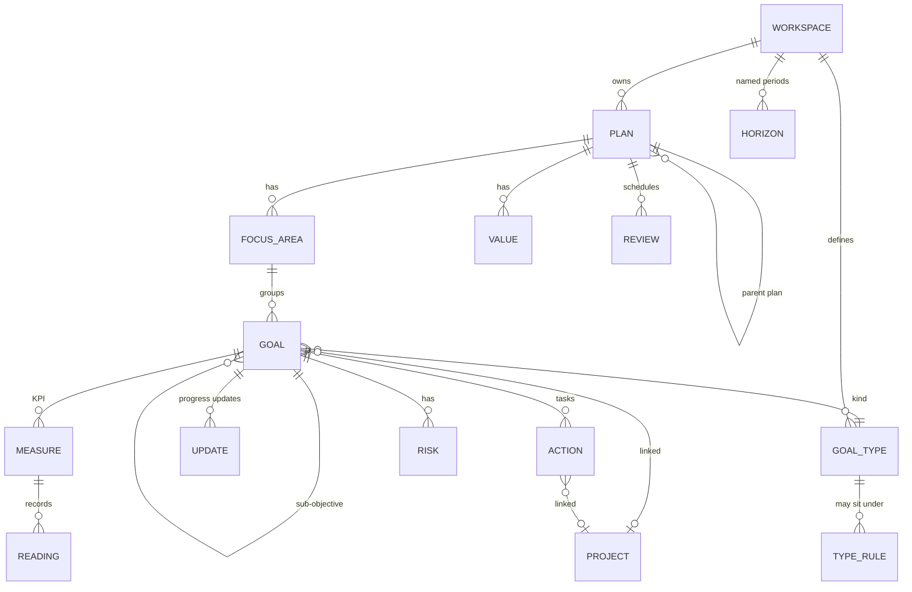

# Cascade Copy Planner: Product and Design Specification

For Claude Design. Describes the Planner as it exists on branch `feature/planner`, what was verified, and what is still missing.
Status legend used throughout: **V** verified working (exercised in a browser or by an automated test) · **I** implemented, not fully verified · **P** proposed, not built · **M** missing or unsupported.

## Contents
1. [Application overview](#1-application-overview)
2. [Navigation and screen inventory](#2-navigation-and-screen-inventory)
3. [Feature inventory](#3-feature-inventory)
4. [Workflows](#4-workflows)
5. [Data model](#5-data-model)
6. [Design conventions and guidance](#6-design-conventions-and-guidance)
7. [Screen-by-screen design brief](#7-screen-by-screen-design-brief)
8. [Cascade comparison and evidence](#8-cascade-comparison-and-evidence)
9. [Known gaps and open questions](#9-known-gaps-and-open-questions)
10. [Guidance for Claude Design](#10-guidance-for-claude-design)

---

## 1. Application overview

**What it is.** Planner is the strategy-planning app of the Layer2Funnels (L2F) + Aurj ecosystem. Teams write a plan (vision, values), split it into **focus areas** (themes), set **objectives** under them (with sub-objectives), track each objective with a **KPI/measure** or with actions, post progress **updates**, hold **reviews**, and turn objectives into **tasks**. It is modelled on Cascade (cascadestrategy.com), simplified for a small team.

**Users (from the role and permission model).**
| Person | Can do |
|---|---|
| Owner / admin (`plan.manage`) | Everything: plans, focus areas, strategy model, reviews, archiving |
| Editor | Add and edit objectives, post updates, manage tasks (rights are set per workspace) |
| Objective owner | Post updates and change status/progress on their own objectives |
| Viewer | Read only |
| No Planner grant | Sees nothing ("No access") |

**Two organizations.** Layer2Funnels (yellow brand) and Aurj (plum/teal). Data never crosses organizations; the UI switches theme per organization.

**Strategy versus execution.**
- Strategy = plan → focus areas → objectives → KPIs. Answers "what do we want and how do we know".
- Execution = tasks (called *actions* in the database) attached to objectives, optionally linked to an existing project. Answers "who does what by when". Tasks appear in **My work**.
- The bridge is **Turn into work** (section 4.7).

**Main journeys.** (1) Create plan → add focus areas → add objectives and KPIs → review progress. (2) Weekly: see what needs me (Home, bell) → post update. (3) Periodic: hold a review. (4) Admin: shape the strategy model (kinds of objective and what can sit under what).

---

## 2. Navigation and screen inventory

Routing is hash-based: `#/planner/<page>?plan=<id>&goal=<id>`. The organization comes from sign-in, never the URL. Source: `apps/planner/src/state/route.ts`.

**Shell** (`shell/Shell.tsx`) · V
- Left rail (252px): brand, organization select, menu (Home, My work, Plans, Alignment, Reports), Admin section (Strategy model, shown only with `plan.manage`), signed-in user. Collapses to a slide-over menu under 900px.
- Top bar: page title and crumb, global search (`/` or Ctrl+K), **Create** menu (New objective, New focus area, New plan, Schedule a review, Turn strategy into work), notifications bell, colour scheme toggle.
- Plan bar (on plan pages): plan select, favourite star, overall progress, "review overdue" flag.
- Tabs under the plan bar for Plans (Planner · Timeline · Reviews · Settings), Reports (Summary · All objectives · Metrics), Strategy model (Types and structure · Time horizons · Templates).
- Objective **drawer** slides over any page when `goal=<id>` is in the URL.

| Screen | Route | Purpose | Key actions | Status |
|---|---|---|---|---|
| Home | `overview` | What needs attention in the open plan: counts, attention list, focus-area progress, upcoming reviews | Open objective, go to Reviews | V (earlier sessions) |
| My work | `mine` | My objectives and my tasks, tasks in five status columns | Change task status, open objective | I |
| Plans | `plans` | Table of all plans in the organization (progress, focus areas, owner, next review) | Open, search, favourites, show archived, New plan | V |
| **Planner** | `map` | The working screen: the plan's focus areas and objectives | See section 7.1 | V |
| Timeline | `map?view=timeline` | Gantt of objectives with dates | Open objective | I |
| Reviews | `reviews` | Schedule and hold reviews; held reviews freeze a snapshot | Schedule, hold, skip | I |
| Plan settings | `settings` | Plan details, vision, values, focus areas, review rhythm, archive/restore | Edit, add and reorder focus areas | V (focus areas) |
| Alignment | `alignment` | Tree of plans (parent → child), or objectives of one plan; zoom, expand/collapse | Open plan or objective | V (render) |
| Reports → Summary | `reports` | Roll-ups by focus area and owner, risks, overdue, stale | Export | I |
| Reports → All objectives | `goals` | Flat sortable table, bulk edits, CSV import and export | Edit, bulk change, import | I |
| Reports → Metrics | `metrics` | Every KPI with latest reading, trend, record reading | Record reading | I |
| Strategy model | `model` | Admin. Tabs: **Strategy map** (pick or create a strategy and build it on a left-to-right map: Strategy (its pool of kinds) → **one block per focus area** → the kinds that sit directly in that focus area (*Kinds here*) → what each kind can hold, KPI types and Tasks; add, remove and connect in place; *Create a plan from it*), **Objective kinds** (kinds, nesting, structure map incl. saved focus areas), **KPI types**, **Focus areas** (reusable list), Time horizons | Create/edit/delete strategies, KPI types, saved focus areas, kinds, nesting, horizons | V (strategies, plan from strategy, focus bands), I (other edits) |
| Templates | `templates` | Start a plan from a template | Create plan | I |

**Dialogs and panels** (all opened through `components/Dialogs.tsx` so each exists once): Objective form, Plan form, **Focus area dialog**, **Turn into work dialog**, Confirm, Filters popover, Display popover, Saved views menu, custom date-range dialog, Notifications popover, Import dialog, Objective drawer (tabs: Overview · Updates · Measures · Actions · Risks · Comments · History).

**States.** Every page has loading (skeleton / "Loading plan…"), empty (explains and offers the next step), error (plain words, retry), and permission-denied ("Not available" or disabled buttons with a reason in the tooltip). A plan address that does not exist or is not visible says "That plan isn't available".

---

## 3. Feature inventory

| Feature | Status | Evidence |
|---|---|---|
| Plans: create, edit, archive, restore, switch, favourite, parent plan | V | `planner.test.mjs`; Plans screen in browser |
| Focus area create from Planner page, Board, Create menu, Settings (one shared dialog) | **V** | Browser: created, validated, persisted after reload; `client.test.ts` |
| Focus area edit, reorder, archive, restore (Settings) | V (edit), I (rest) | Browser (edit); DB tests |
| Focus area dates and Upcoming/Current/Ended chip | V | Browser band; `focusTimeState` |
| Focus area band with progress, counts, actions | **V** | Browser, desktop and phone width |
| Objectives: create, edit, sub-objectives, kinds, owner, status, priority, weight, dates, tags | V | DB tests, browser |
| Objective nesting rules from the strategy model | V | DB tests (P25) |
| KPIs: measure on an objective (unit, direction, start, target), readings, progress from measure | V | DB tests; `client.test.ts` |
| Progress modes: manual, measure, children, actions | V | DB tests |
| Update schedule (weekly…quarterly), next update due, overdue reason | V | `lib.test.ts`; browser |
| Notifications (late updates, overdue objectives, overdue reviews) | V (appears, counts); I (all rules) | Browser |
| Filters, Display, Saved views, Hide completed, periods (named time horizons) | V (open), I (all) | Browser |
| Views: List (default), Board, Timeline | V (List), I (Board, Timeline) | Browser |
| **Turn into work** (tasks from objectives, project link, duplicate skip, summary) | **V** | Browser: created, second pass "Nothing to create"; `client.test.ts` |
| Reviews with frozen snapshots | V | DB tests |
| Alignment (plans tree, objectives tree) | V render | Browser |
| Strategy model admin | V render, I edits | Browser, DB tests |
| Permissions and organization isolation | V | 277 database checks (47 isolation, 64 audit, 25 authorization, 132 planner, 9 errors); app tests |
| Dark and light themes, two organization palettes | V | Browser |
| Create a *project* from the strategy | **M** | See 5 and 9 |
| **Strategies** (Cascade's plan types): define once in Strategy model with its kinds of objective and starting focus areas; pick when creating a plan; plan then starts with those focus areas and only offers those kinds | **V** | DB checks P28a-j; app test; browser: strategy created, plan created from it, bands appear |
| **KPI types** (Cascade's measure types): reusable name/unit/direction tied to kinds; picked when adding a KPI | V (DB, app test), I (UI) | P28f |
| **Reusable focus areas**: created and managed in Strategy model, picked when adding a focus area to a plan, shown in the structure map | V (DB, UI created in browser earlier flow), I (picker) | P28a |
| Add menu on each objective row: sub-objective, KPI, task (drawer opens on the right tab) | I | GoalTree, gtab link |
| "Enable status" per objective kind | **M** | Video; Cascade recheck section 1 |
| Separate action types | **M** | Cascade has 2 action types; Planner has one task kind |
| Plan-level custom fields, privacy per plan, teams | **M** | Video 1:56 |
| Inline "+" between focus areas | **P** | Video 0:10 |
| Real-time collaboration, notifications by email | **M** | n/a |

---

## 4. Workflows

### 4.1 Create or switch a plan · V
Plans → **New plan** (name, description, vision, dates, *Part of plan*, review rhythm) → plan opens. Switch with the plan select in the plan bar; the URL carries `plan=`. Validation: name required, end not before start. Errors show in the dialog.

### 4.2 Create a focus area from the Planner page · V
Entry points: **Add focus area** button in the Planner header; dashed **+ Add focus area** row under the list; last column of the Board; Create menu → *New focus area*; Settings → *Add focus area*. All open the same dialog: name (required, unique within the plan), description, starts, ends, colour (next unused colour pre-selected).
Result: saved against the open plan, the band appears immediately, a success toast shows, no refresh. Validation: blank or duplicate name, end before start. Only `plan.manage` users see enabled buttons; others get disabled buttons with a reason. Edge cases: archived plan (read-only); a focus area can be archived only when it has no active objectives.

### 4.3 Manage focus areas in Settings · V
Plans → Settings → Focus areas: list with colour, dates, count; ↑/↓ reorder; Edit (same dialog); Archive; Restore. Unchanged capability, now shares the dialog.

### 4.4 Create and organise objectives · V
**+ Add objective** in a band (pre-selects that focus area), the page header, a row's **+** (sub-objective), or Create. Form: title, kind, focus area, parent, owner, status, priority, weight, dates, progress source, update schedule, value, project, tags. Nesting is checked against the strategy model. Reorder or re-parent on the Board by drag, or with the card ⋯ menu (keyboard and phone).

### 4.5 Create and connect KPIs · V (via objective)
Choose a kind marked "tracked by a measure" (e.g. KPI) and tick *Track with a measure*: name, unit, direction, start, target. Record readings in the objective drawer (Measures tab) or Reports → Metrics. Progress follows readings. **Gap:** there is no one-click "add success criteria" row like Cascade's; see 9.

### 4.6a Define a strategy once, reuse it · V (strategy, plan from strategy); I (other tabs)
Entry: Admin → Strategy model.
1. **Objective kinds** tab: kinds exist (Objective, KPI, Initiative, Project); add more; nesting rules set what may sit under what.
2. **Focus areas** tab: add reusable focus areas (name, colour, description).
3. **KPI types** tab: add a reusable KPI (name, unit, direction) and tick the kinds it applies to.
4. **Strategy map** tab → *New strategy*, then build it on the map (add focus areas, add or create kinds, set *Can hold*, attach or create KPI types), or fill the same in the dialog: name, description, tick the kinds it uses (none ticked = all), tick and order the focus areas a new plan starts with.
5. Plans → *New plan* → choose **Strategy**. The plan opens with those focus areas as empty bands; Add objective offers only the strategy's kinds; with exactly one kind the button reads "Add <Kind>"; a KPI form offers the matching KPI types.
6. Adding a focus area to a plan offers the saved ones ("Start from a saved focus area") or a new one, optionally saved for reuse.
Validation: names required and unique per organization; the database refuses a kind outside the strategy and a KPI type outside its kinds; a plan keeps its strategy; deleting a strategy keeps its plans. Needs `plan.manage`.

### 4.6 Build and edit the strategy structure · V / I
Planner page is where the strategy is built (focus areas → objectives → KPIs). Strategy model (admin) defines the allowed kinds and nesting; its map shows the shape and "looping" kinds. Edits persist; reopening shows them. Alignment shows how plans connect.

### 4.7 Turn strategy into work · V
Entry: **Turn into work** on a focus-area band, or Create → *Turn strategy into work* (whole plan).
1. Dialog lists open, leaf objectives (those with no sub-objectives) of the chosen scope, all ticked.
2. For each, proposed tasks appear (editable): "Plan the first steps for …"; "Record the first reading for <KPI>" when a KPI has no readings yet; "Choose an owner for …" when unowned.
3. Optional **Link to a project** (existing projects only). Tasks, and objectives that have no project, are linked.
4. Footer button says exactly how many tasks will be created. Nothing is saved before **Create**.
5. Result list per objective: created, skipped, project linked, errors.
Duplicate protection: a proposed task whose title (case-insensitive) matches an existing task of that objective is shown as "Already exists, skipped" and cannot be created; the same applies to a title edited into an existing one. Tasks copy owner, priority and due date from the objective and note which objective they came from. Requires `action.manage`.
**Not supported:** creating projects (the ecosystem `projects` table has only id, workspace, client, name and no creation API from Planner); creating KPIs or objectives from strategy (they already are the strategy); tasks live only in the Planner (`planner_actions`); there is no separate tasks app to integrate.

### 4.8 Updates, overdue and notifications · V
Objective drawer → Updates → post status, progress, confidence, summary. The bell lists *your* late updates, *your* overdue objectives and overdue reviews; each item opens the objective or Reviews. Home lists the same reasons for the whole plan.

### 4.9 Filters, Display, Saved views, Board, Timeline · V (open) / I
Search box plus **Filters** (status, owner, kind, priority, focus area, tag, period, overdue, with risks, no owner, stale, hide completed, include archived), **Display** (group, sort, order, colour), **Saved views** (save, apply, delete; private to the person). List/Board toggle; Timeline is a tab.

### 4.10 Administration and permissions · V
Strategy model and Plan settings need `plan.manage`; reviews need `review.manage`; tasks need `action.manage`. Every disabled control explains why. Archive-before-delete; history is append-only.

---

## 5. Data model

Names: a **goal** in the database is an **objective** on screen; an **action** is a **task**; a **measure** is a **KPI**.

- Ownership boundary: every row carries `workspace_id`; composite foreign keys stop cross-organization links; row-level security on every table; API functions are `security invoker`, so a denied read looks like "not found".
- One-to-many: plan→focus areas, focus area→objectives, objective→sub-objectives, measures, updates, tasks, risks. A parent plan has many child plans. No many-to-many relations exist except objective-kind nesting rules.
- Constraints: objective depth is limited; held reviews and updates are immutable; a measure's current value changes only through readings; progress source is fixed per objective; wont-do tasks are excluded from action-based progress.
- Execution link: `planner_actions.goal_id` (task under objective) and optional `project_id`; `planner_goals.project_id`. Projects themselves belong to the wider ecosystem.
- New (migrations 0005/0006): planner_strategies (+ planner_strategy_kinds, planner_strategy_focus), planner_focus_templates, planner_measure_types (+ planner_measure_type_kinds), planner_plans.strategy_id (fixed at creation), planner_measures.measure_type_id. A strategy limits the kinds a plan may use (database guard) and seeds its focus areas. planner_strategy_focus_kinds gives each focus area of a strategy its own kinds (none = the strategy's pool); plan focus areas keep 	emplate_id so the rule applies, and it takes precedence over the global top-level nesting rule. Sub-objectives follow the nesting rules.
- Proposed, not built: per-kind "enable status", separate action types, task-to-strategy back-link beyond the objective.
Evidence: `migrations/0005_planner.sql`, `0006_planner_api.sql`, `apps/planner/src/api/types.ts`.

---

## 6. Design conventions and guidance

**Existing (Design v4 "Signal").** Fonts: Bricolage Grotesque (display), Geist (text), Geist Mono (numbers). Light and dark. `data-org` switches brand: L2F yellow `#FFC633` with blue action `#2B63F6`; Aurj plum `#B0305A` with teal action. Radii 10/14/22. Buttons have a 3D edge. 44px touch targets. 252px rail. Patterns: page head, toolbar, tabs, table, board columns, gantt, drawer, popover, dialog, toast. Focus areas use seven colours (blue, coral, teal, amber, violet, green, slate) as `--fa-<name>`.
**Verified usability fixes already made.** One Filters button and one Display button replace a row of selects. Menu reduced to five items plus an admin item. "Goal" renamed "objective" everywhere. Settings no longer the only place to add a focus area.
**Opportunities.**
- Focus-area band could become a card with a progress ring and a mini status bar (currently one line).
- Inline "+" between bands, as in Cascade, to insert a focus area where you are looking.
- A one-click "Add KPI" on each objective row.
- Strategy model page is still a list plus a read-only map; make nodes clickable to edit nesting directly on the map.
- Desktop table is wide; at phone width it scrolls sideways. Consider a card list under 700px.
- Bell and Filters panels are popovers; on phone they should become bottom sheets.
**Accessibility.** Verified in code and spot checks: fields are labelled, Escape closes popovers, buttons are disabled with a reason, band buttons carry screen-reader text naming the focus area. Implemented but not tested with a screen reader: focus handling in dialogs. Not verified: full keyboard drag-and-drop alternative on Board (the card ⋯ menu is the alternative), contrast of Cascade-like tinted chips in dark mode.
**Reusable components.** `Dialog`, `Drawer`, `Popover`, `MenuButton`, `Chip`, `ProgressBar`, `StatusBadge`, `TreeBranch`, `FocusBand`, `FocusAreaDialog`, `ColorPicker`, `FilterBar`, `Table`, `EmptyState`.

---

## 7. Screen-by-screen design brief

### 7.1 Planner (`map`) · most important
Purpose: build and run the strategy of one plan.
Hierarchy: title → actions row (**Add focus area**, List/Board, **Add objective**) → find/arrange (search, Filters, Display, Saved views) → focus-area bands each followed by its objectives → dashed **+ Add focus area**.
Band: colour edge, name (largest text on the page after the title), time chip, dates, objective count, average progress, **+ Add objective**, **Turn into work**, **Edit**.
Objective row: title (opens drawer), kind chip, owner, status, progress with expected-pace marker, schedule, due, **+** sub-objective, ⋯ menu.
States: no focus areas (explain and **Add your first focus area**), no objectives in a band, no match for filters, archived plan banner (read-only).
Mobile: bands wrap; band actions take a full row; table scrolls horizontally (design a card list).

### 7.2 Focus area dialog
Name, description, dates, colour. Primary: Add/Save. One dialog for create and edit; do not design a second form.

### 7.3 Turn into work dialog
Scope text, project select, one fieldset per objective with editable proposed tasks, live count, confirm, then result list. Keep the "nothing is created until you confirm" message.

### 7.4 Strategy model
Left: element list (kinds with counts, + add). Right: structure map (plan → focus area → kinds, looping kinds marked) and nesting editor. Tabs for time horizons and templates. Admin only.

### 7.5 Alignment
Left-to-right tree, boxes with progress, expand/collapse, zoom, Plans/Objectives toggle.

### 7.6 Home, My work, Plans, Reviews, Reports, Metrics, Plan settings
Retain the current structure (see 2). Home: counts, attention list with reasons, focus-area rollups. My work: objectives and a five-column task board. Reviews: scheduled and held lists with snapshot. Reports: summary tables, flat table with bulk edit, metrics table. Settings: vision, values, focus areas, rhythm, archive.

### 7.7 Objective drawer
Header (title, status, owner, priority, actions menu); tabs Overview (progress, schedule, details incl. update schedule), Updates, Measures, Actions, Risks, Comments, History.

---

## 8. Cascade comparison and evidence

Sources: (a) the supplied recording and its caption file ("Create and reuse strategy and focus areas.srt": the author wants a *strategy* created once in the Strategy model, objectives and measures connected to it, then *selected* when creating a plan, and focus areas likewise created once and reused); (b) a second live Cascade pass on 2026-10-28 (read-only, notes in 
echeck_strategy_model.md); (c) the supplied recording "Strategy model - Administration - Cascade" (awesomescreenshot, 2:32; frames viewed at 0:10, 0:46, 1:03, 1:21, 1:41, 1:56, 2:21; no audio or transcript available to me); (b) live Cascade exploration in earlier sessions (Classic and Playground), notes in `Downloads\l2f-research\cascade-planner`; (c) the repository.

| Area | Cascade (observed) | Planner | Class |
|---|---|---|---|
| Plan page with focus-area bands and objectives | Bands with objective rows, `+` inserts, "Add success criteria" (0:10) | Bands with rows, buttons in band | Working in both; inline `+` and success-criteria shortcut missing |
| Add focus area from plan page | Yes | Yes, five entry points | Fixed |
| Strategy model admin: create plan type (icon, title, description, objective types available) | Yes (0:46) | **Strategies** tab: name, description, kinds, starting focus areas | Working in both (no icon) |
| Create objective type: enable status, plan contributions, parent objective types, success-criteria checklists (recheck: Strategy model, Objective types form) | Yes | Kinds with nesting rules; a strategy lists which kinds a plan may use | Partly: no per-kind status switch |
| Create measure type with contributing objective kinds | Yes | KPI types tied to kinds, picked in the objective form | Working in both |
| Create action type | Yes (2 types) | One task kind | Missing |
| Focus areas: workspace-wide list; plan Add dialog "select an existing focus area or create new" | Yes | Reusable list in Strategy model; the plan dialog picks from it or creates new | Working in both |
| Create plan from type: type, name, description, field template, time horizon, team, parent plan, privacy (1:56) | Yes | **Strategy**, name, description, vision, dates, parent plan, review rhythm | Partly: no field template, team, privacy |
| Plans list with parent, focus areas, objectives (1:41) | Yes | Yes | Working in both |
| Empty new plan shows "+ Add objective <type>" (2:21) | Yes | Empty state with Add focus area | Working in both (different wording) |
| Alignment map, Strategy map diagram | Yes | Yes | Working in both |
| Update schedules and reminders | Yes | Yes (cadence, bell, Home) | Working in both |
| Named time horizons | Yes | Yes | Working in both |
| Strategy to execution | Projects and tasks as plan/objective types | Tasks under objectives, link to existing projects | Planner design is narrower |
| Integrations, dashboards, AI, Insights | Yes | Reports only | Not applicable for now |

---

## 9. Known gaps and open questions
1. **No per-kind status switch, action types, plan privacy, teams or custom-field templates.** Cascade has them. (Plan types now exist as *Strategies*; KPI types as *KPI types*.) A plan keeps the strategy it was created with.
2. **Projects cannot be created from Planner.** The `projects` table is minimal and owned elsewhere. Conversion links existing projects only.
3. **Task generation is deliberately simple** (three suggestion rules, all editable). Whether to derive tasks from sub-objectives, measure cadence, or templates is a product decision.
4. **Conversion is not atomic.** Tasks are saved one by one; a failure shows per-objective errors and is safe to retry (duplicates are skipped).
5. Not verified in a browser: Board drag-and-drop, Timeline, Reviews hold flow, Import, Strategy model edits, keyboard-only use, real Supabase backend (the Supabase adapter has never run live).
6. Desktop-width layout was seen at about 1000px wide; the review pane limited wider checks.
7. The Design v4 `DESIGN_SYSTEM.md` was not in the repository; conventions above come from the CSS and the v4 prototype.
8. The recording has no transcript; findings come from seven viewed frames, not the full 2:32.

---

## 10. Guidance for Claude Design
- This document describes the real product and its verified behaviour, not a visual concept. Statuses **V / I / P / M** matter: design verified features as they are, mark proposed features as proposals, and do not present missing ones as working.
- Design the whole application (every screen in section 2), not one attractive screen. Keep the shell, spacing, chips, tables, dialogs and states identical across screens and breakpoints.
- The **Planner page** and **Strategy model** must give a coherent, discoverable workflow: see the structure, add to it where you are looking, edit in place, and see the result at once.
- **Focus areas must be visually prominent** and manageable from both the Planner page and Settings. Treat the focus-area band as a primary element, not a label.
- Strategy building is about creating, editing, connecting and saving: design for creation first (empty states), then editing, then reading.
- Reuse components (section 6). Prefer extending `FocusBand`, `Popover`, `Dialog` over inventing one-offs.
- Keep the vocabulary: objective, KPI, task, focus area, plan. Do not reintroduce "goal" or "action" on screen.
- Both organization palettes and both colour schemes must work.
- When something here is unclear or marked missing, flag the question instead of inventing behaviour.

*Maintainers: update sections 2, 3 and 9 whenever a screen or feature changes. Last verified: commit `01c9a75b` plus this document.*
