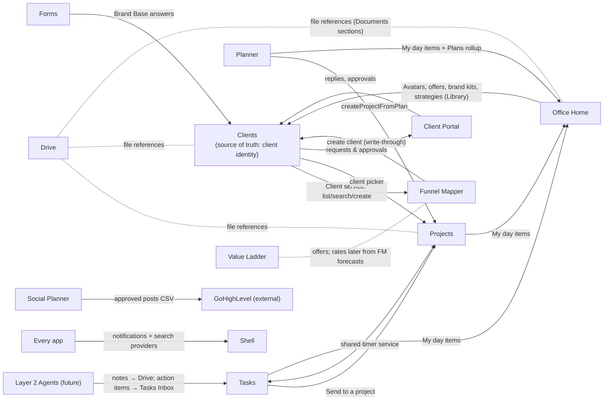

# App relationship map

Rules: each record lives in one app; other apps hold references (ids/links), never copies — except client strategy assets, which are **client-owned copies** (locked decision). Details: `00_MASTER_DOCUMENTATION/03_PERMISSIONS_DATA_INTEGRATIONS.md` §3–6.
