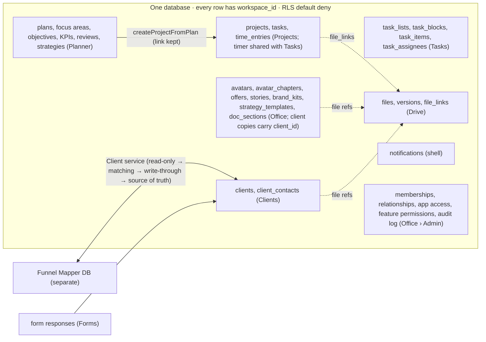

# Data flow

Table names marked in the briefs ([N]) are proposals in the design; the repo's existing tables win where they already exist. Ownership and versioning rules: `00_MASTER_DOCUMENTATION/03_PERMISSIONS_DATA_INTEGRATIONS.md` §3–5.
