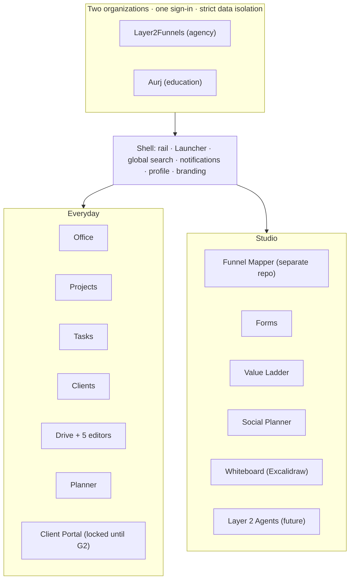

# Ecosystem map

| App | Pages documented | Templates | Build prompt |
|---|---|---|---|
| Global shell, Launcher and Profile | 9 | 9 | P00 |
| Office | 39 | 39 | P01 |
| Clients | 34 | 34 | P02 |
| Projects | 17 | 16 | P03 |
| Tasks | 7 | 6 | P04 |
| Drive and editors | 13 | 13 | P05 |
| Planner | 17 | 17 | P06 |
| Funnel Mapper | 10 | 10 | P07 |
| Client Portal | 5 | 5 | P08 |
| Whiteboard | 5 | 5 | P09 |
| Forms | 4 | 4 | P10 |
| Value Ladder | 3 | 3 | P11 |
| Social Planner | 7 | 7 | P12 |
| Layer 2 Agents | 9 | 9 | P13 |
