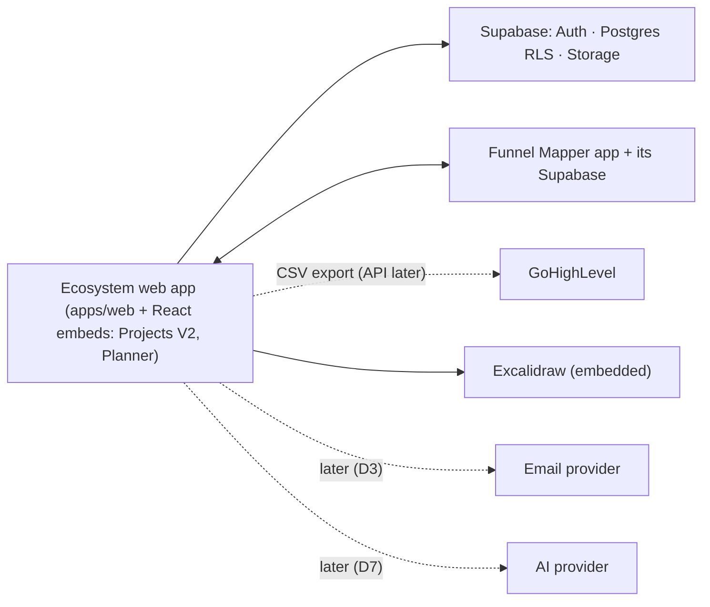

# Integration architecture

| System | Relationship | Status |
|---|---|---|
| **Funnel Mapper** (separate repo `Funnel-Mapper`, Next.js + Supabase) | Rendered inside the ecosystem shell when opened from it; clients via the ecosystem Client service in four safe steps | Confirmed; timing D1/D2 |
| **GoHighLevel / ClickFunnels** | Funnels are built there; Clients › Build tracks progress only; Social Planner exports approved posts as CSV ("Send approved to GHL"); API later | Confirmed; API = [F] |
| **Excalidraw (MIT)** | Whiteboard canvas; use its own UI options | Confirmed |
| **Email provider** | Invitations and digests | Unresolved (D3); in-app only now |
| **AI provider** (Layer 2 Agents, Ask, avatar import) | Not chosen; avatar import parses DOCX/PDF locally on the server | Unresolved (D4, D7) |
| **Realtime presence** | Editors show "Last edited by" until a channel exists | Unresolved (D5) |
| **Supabase** (Auth, Postgres RLS, Storage) | Platform for the ecosystem | Confirmed (repo) |

