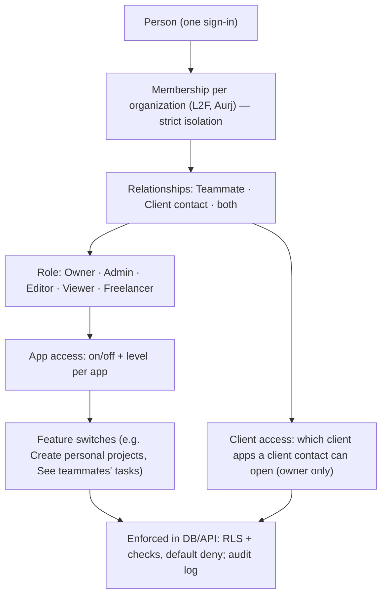

# Permission and access architecture

- Owner manages teammates **and** client access; Admin manages teammates only (sees client access read-only).
- Personal spaces (personal projects, personal task lists, private tasks) are visible to their owner only — even admins cannot see them (private tasks appear as a count).
- Check access (person page) and Access review (with last_used_at) explain effective access.
- Full rules: `00_MASTER_DOCUMENTATION/03_PERMISSIONS_DATA_INTEGRATIONS.md` §1–2. Test matrix: `07_PROMPTS/FUNCTIONAL_TESTING_MASTER_PROMPT.md`.
