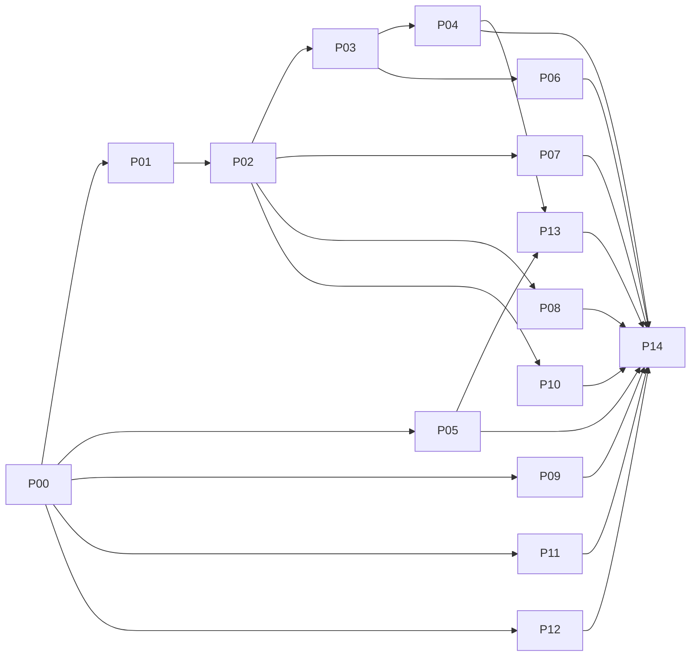

# Implementation sequence

One app at a time. Each step: plan → Tabish approves → build → tests → report → approval. Prompts in `07_PROMPTS/`.

| Step | Prompt | App | Depends on | Why here |
|---|---|---|---|---|
| 00 | `P00` | Global shell, Launcher and Profile | — | Every app depends on the shell, tokens, search, notifications |
| 01 | `P01` | Office | P00 | Permissions and branding live in Office › Admin |
| 02 | `P02` | Clients | P00, P01 | Client identity (Client service) is used by Funnel Mapper and Projects |
| 03 | `P03` | Projects | P00–P02 | Skin of V2 + Files + personal projects; provides createProjectFromPlan and the shared timer |
| 04 | `P04` | Tasks | P03 (shared timer, Send to project) | New app; needs Projects (timer, Send to project) |
| 05 | `P05` | Drive and editors | P00 | Files referenced by Projects, Clients, Office |
| 06 | `P06` | Planner | P03 (createProjectFromPlan) | Design-only + Strategy builder + plan → project (needs P03) |
| 07 | `P07` | Funnel Mapper | P02 (Client service) | Rename, sizing, shared clients (needs P02) |
| 08 | `P08` | Client Portal | P00, P02 (requests/approvals) | Needs Clients requests/approvals; stays locked (G2) |
| 09 | `P09` | Whiteboard | P00 | Independent |
| 10 | `P10` | Forms | P00, P02 (Brand Base answers) | Brand Base answers feed Clients |
| 11 | `P11` | Value Ladder | P00 | Independent |
| 12 | `P12` | Social Planner | P00 | Independent |
| 13 | `P13` | Layer 2 Agents | P00, P04 (Tasks Inbox), P05 (Drive) | Preview only; needs Tasks Inbox and Drive |
| 14 | `P14_FULL_REGRESSION_CHECK.md` | Whole ecosystem | all | Release gate |

Also: `ECOSYSTEM_IMPLEMENTATION_MASTER_PROMPT.md` once at the start; `DESIGN_QUALITY_ASSURANCE_PROMPT.md`, `ACCESSIBILITY_AND_USABILITY_REVIEW_PROMPT.md` and `MOBILE_RESPONSIVENESS_MASTER_PROMPT.md` after each app; `FUNCTIONAL_TESTING_MASTER_PROMPT.md` with P14.

